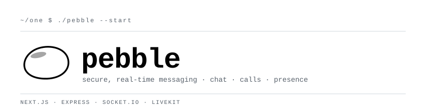
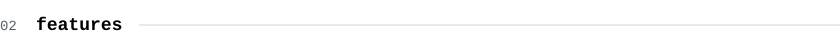
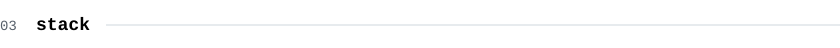
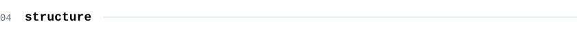
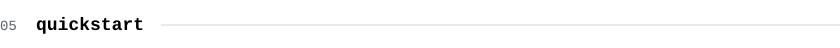
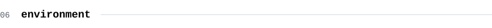
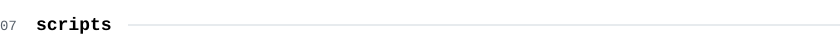
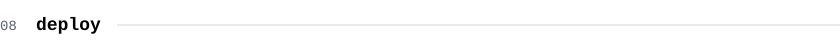
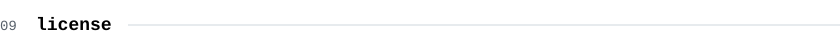

<picture><source media="(prefers-color-scheme: dark)" srcset="assets/dark/header.svg"/></picture>

<div align="center">

<a href="https://github.com/J33rry/One"><picture><source media="(prefers-color-scheme: dark)" srcset="https://img.shields.io/badge/REPO-0d1117?style=flat-square&logo=github&logoColor=ffffff"/></picture></a>
<a href="#05-quickstart"><picture><source media="(prefers-color-scheme: dark)" srcset="https://img.shields.io/badge/QUICKSTART-0d1117?style=flat-square&logo=rocket&logoColor=ffffff"/></picture></a>
<a href="#08-deploy"><picture><source media="(prefers-color-scheme: dark)" srcset="https://img.shields.io/badge/DEPLOY-0d1117?style=flat-square&logo=vercel&logoColor=ffffff"/></picture></a>
<a href="#09-license"><picture><source media="(prefers-color-scheme: dark)" srcset="https://img.shields.io/badge/LICENSE%20ISC-0d1117?style=flat-square&logoColor=ffffff"/></picture></a>

</div>

<br>

<a id="01-overview"></a>
<picture><source media="(prefers-color-scheme: dark)" srcset="assets/dark/s01.svg"/></picture>

**Pebble** is a secure, real-time messaging platform — direct and group chat, audio and
video calls, live presence and typing, media sharing, and a soft lavender interface that
follows your system theme.

```
status    building
web       next.js 16 · react 19 · tailwind v4
server    express 5 · socket.io · drizzle · postgres · redis
calls     livekit
media     cloudinary
```

<br>

<a id="02-features"></a>
<picture><source media="(prefers-color-scheme: dark)" srcset="assets/dark/s02.svg"/></picture>

| feature | what it does |
| --- | --- |
| `messaging` | 1:1 and group chats — edit, delete, replies, reactions, mentions, read / delivery status |
| `real-time` | Socket.IO gateway for live messages, presence (online / last seen) and typing indicators |
| `calls` | audio and video calls powered by [LiveKit](https://livekit.io) |
| `media` | image, video, file and voice-note sharing via [Cloudinary](https://cloudinary.com), with an in-app lightbox |
| `folders` | organise chats into folders, plus favourites and unread tracking |
| `contacts` | send, accept and reject contact requests |
| `auth` | Redis-backed sessions with password (Argon2) **and** Google sign-in, plus email password reset |
| `theming` | "Pebble" design system — full light / dark, follows the OS or an in-app toggle |

<br>

<a id="03-stack"></a>
<picture><source media="(prefers-color-scheme: dark)" srcset="assets/dark/s03.svg"/></picture>

<div align="center">

<picture><source media="(prefers-color-scheme: dark)" srcset="https://img.shields.io/badge/Next.js-0d1117?style=flat-square&logo=nextdotjs&logoColor=ffffff"/></picture>
<picture><source media="(prefers-color-scheme: dark)" srcset="https://img.shields.io/badge/React-0d1117?style=flat-square&logo=react&logoColor=ffffff"/></picture>
<picture><source media="(prefers-color-scheme: dark)" srcset="https://img.shields.io/badge/TypeScript-0d1117?style=flat-square&logo=typescript&logoColor=ffffff"/></picture>
<picture><source media="(prefers-color-scheme: dark)" srcset="https://img.shields.io/badge/Tailwind%20CSS-0d1117?style=flat-square&logo=tailwindcss&logoColor=ffffff"/></picture>
<picture><source media="(prefers-color-scheme: dark)" srcset="https://img.shields.io/badge/TanStack%20Query-0d1117?style=flat-square&logo=reactquery&logoColor=ffffff"/></picture>
<picture><source media="(prefers-color-scheme: dark)" srcset="https://img.shields.io/badge/Zod-0d1117?style=flat-square&logo=zod&logoColor=ffffff"/></picture>

<picture><source media="(prefers-color-scheme: dark)" srcset="https://img.shields.io/badge/Node.js-0d1117?style=flat-square&logo=nodedotjs&logoColor=ffffff"/></picture>
<picture><source media="(prefers-color-scheme: dark)" srcset="https://img.shields.io/badge/Express-0d1117?style=flat-square&logo=express&logoColor=ffffff"/></picture>
<picture><source media="(prefers-color-scheme: dark)" srcset="https://img.shields.io/badge/Socket.IO-0d1117?style=flat-square&logo=socketdotio&logoColor=ffffff"/></picture>
<picture><source media="(prefers-color-scheme: dark)" srcset="https://img.shields.io/badge/PostgreSQL-0d1117?style=flat-square&logo=postgresql&logoColor=ffffff"/></picture>
<picture><source media="(prefers-color-scheme: dark)" srcset="https://img.shields.io/badge/Drizzle-0d1117?style=flat-square&logo=drizzle&logoColor=ffffff"/></picture>
<picture><source media="(prefers-color-scheme: dark)" srcset="https://img.shields.io/badge/Redis-0d1117?style=flat-square&logo=redis&logoColor=ffffff"/></picture>
<picture><source media="(prefers-color-scheme: dark)" srcset="https://img.shields.io/badge/LiveKit-0d1117?style=flat-square&logo=livekit&logoColor=ffffff"/></picture>
<picture><source media="(prefers-color-scheme: dark)" srcset="https://img.shields.io/badge/Cloudinary-0d1117?style=flat-square&logo=cloudinary&logoColor=ffffff"/></picture>
<picture><source media="(prefers-color-scheme: dark)" srcset="https://img.shields.io/badge/Docker-0d1117?style=flat-square&logo=docker&logoColor=ffffff"/></picture>

</div>

<br>

<a id="04-structure"></a>
<picture><source media="(prefers-color-scheme: dark)" srcset="assets/dark/s04.svg"/></picture>

```
.
├── server/                  express api + socket.io gateway
│   ├── index.js             entry: middleware, session, routes, socket.io server
│   ├── docker-compose.yml   local postgres + redis + livekit
│   └── src/
│       ├── config/          env schema & validation
│       ├── db/              drizzle schema + migrations
│       ├── middleware/      requireAuth, access control, errors
│       ├── modules/         auth · users · contacts · chats · folders · messages · media · calls
│       └── ws/              socket.io handlers (call · presence · typing)
│
└── web/                     next.js frontend
    └── src/
        ├── app/             routes: (pebble) auth + (app) route groups
        ├── components/      ui primitives, chats, calls, contacts, settings, layout
        ├── hooks/           useAuth · useSocket · useCall · useTyping · usePresence · …
        └── lib/             api clients + ws client
```

<br>

<a id="05-quickstart"></a>
<picture><source media="(prefers-color-scheme: dark)" srcset="assets/dark/s05.svg"/></picture>

```
requires  node.js 20+ · docker (for local postgres + redis + livekit, or bring your own)
```

**1 — infrastructure**

```bash
cd server
docker compose up -d
```

**2 — server**

```bash
cd server
cp .env.example .env      # fill in the values (see 06 environment)
npm install
npm run db:push           # apply the drizzle schema
npm run dev               # http://localhost:3002
```

**3 — web**

```bash
cd web
# create web/.env.local (see 06 environment)
npm install
npm run dev               # http://localhost:3000
```

Open **http://localhost:3000** and sign up.

<br>

<a id="06-environment"></a>
<picture><source media="(prefers-color-scheme: dark)" srcset="assets/dark/s06.svg"/></picture>

**server** — `server/.env`

| key | req | description |
| --- | :---: | --- |
| `NODE_ENV` | | `development` \| `production` (default `development`) |
| `PORT` | | API port (default `5000`; local dev commonly `3002`) |
| `DATABASE_URL` | ✓ | PostgreSQL connection string |
| `REDIS_URL` | ✓ | Redis connection string (session store) |
| `SESSION_SECRET` | ✓ | 32+ char random string |
| `JWT_SECRET` | ✓ | 32+ char random string (password-reset tokens) |
| `CORS_ORIGIN` | ✓ | exact frontend origin, e.g. `http://localhost:3000` |
| `GOOGLE_CLIENT_ID` | | Google OAuth client ID |
| `LIVEKIT_URL` · `LIVEKIT_API_KEY` · `LIVEKIT_API_SECRET` | | LiveKit config (required for calls) |
| `CLOUDINARY_CLOUD_NAME` · `CLOUDINARY_API_KEY` · `CLOUDINARY_API_SECRET` | | Cloudinary config (required for media) |
| `SMTP_HOST` · `SMTP_PORT` · `SMTP_USER` · `SMTP_PASS` · `EMAIL_FROM` | | password-reset emails. Without it, dev prints the link to the server log and production sends nothing |

> In production the server refuses to start without `GOOGLE_CLIENT_ID`, or with the development defaults for LiveKit, Cloudinary or the secrets. Generate secrets with `openssl rand -base64 48`.

**web** — `web/.env.local`

| key | description |
| --- | --- |
| `NEXT_PUBLIC_API_URL` | API base URL **including** `/api/v1` — e.g. `http://localhost:3002/api/v1` |
| `NEXT_PUBLIC_WEBSOCKET_URL` | Socket.IO origin **without** a path — e.g. `http://localhost:3002` (the client connects over the `/ws` path) |
| `NEXT_PUBLIC_GOOGLE_CLIENT_ID` | Google OAuth client ID |

> `NEXT_PUBLIC_*` values are inlined at build time — rebuild / redeploy after changing them.

<br>

<a id="07-scripts"></a>
<picture><source media="(prefers-color-scheme: dark)" srcset="assets/dark/s07.svg"/></picture>

<table>
<tr><th><code>cd server</code></th><th><code>cd web</code></th></tr>
<tr valign="top"><td>

| command | does |
| --- | --- |
| `npm run dev` | start with nodemon watch |
| `npm start` | start the server |
| `npm run db:generate` | generate migrations |
| `npm run db:push` | push schema to the db |

</td><td>

| command | does |
| --- | --- |
| `npm run dev` | dev server |
| `npm run build` | production build |
| `npm start` | serve the prod build |
| `npm run lint` | run eslint |

</td></tr>
</table>

<br>

<a id="08-deploy"></a>
<picture><source media="(prefers-color-scheme: dark)" srcset="assets/dark/s08.svg"/></picture>

```
web       vercel   root web/
server    render   root server/ · build npm install · start npm start
```

> [!IMPORTANT]
> `*.vercel.app` and `*.onrender.com` are **different sites**, so the session cookie is **cross-site**. For login to persist, configure the cookie for cross-site use in `server/index.js`:
> ```js
> app.set("trust proxy", 1); // Render terminates TLS at a proxy
>
> cookie: {
>   secure: env.NODE_ENV === "production",
>   httpOnly: true,
>   sameSite: env.NODE_ENV === "production" ? "none" : "lax",
>   maxAge: 7 * 24 * 60 * 60 * 1000,
> }
> ```

- **render (server)** — provision Postgres + Redis, set the server env vars with `NODE_ENV=production` and `CORS_ORIGIN` = your exact Vercel URL, then run `npm run db:push` once.
- **vercel (web)** — set `NEXT_PUBLIC_API_URL` → `https://<your-server>.onrender.com/api/v1` and `NEXT_PUBLIC_WEBSOCKET_URL` → `https://<your-server>.onrender.com`.
- **google oauth** — add your Vercel URL to the OAuth client's *Authorized JavaScript origins* in the Google Cloud Console.

<br>

<a id="09-license"></a>
<picture><source media="(prefers-color-scheme: dark)" srcset="assets/dark/s09.svg"/></picture>

<div align="center">

Released under the **ISC License**.

<br>

<sub><code>status: building</code></sub>

</div>
